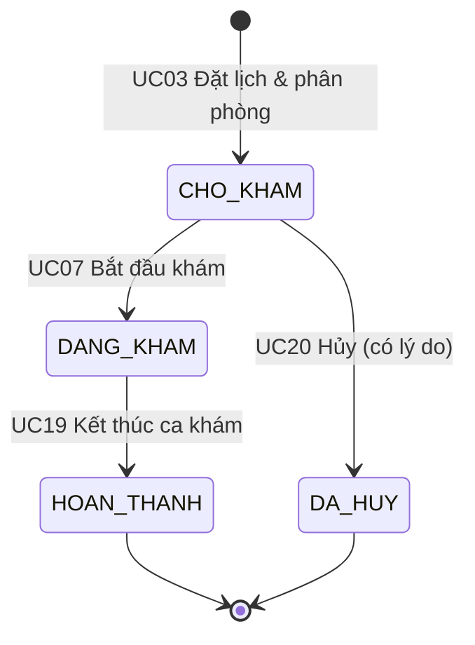
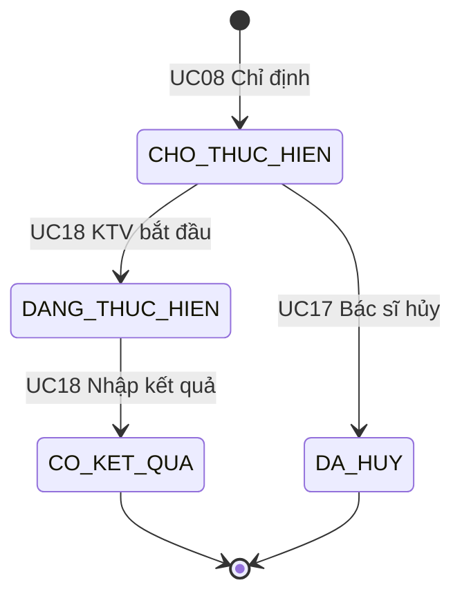
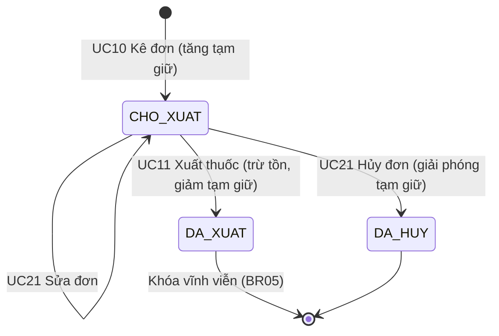
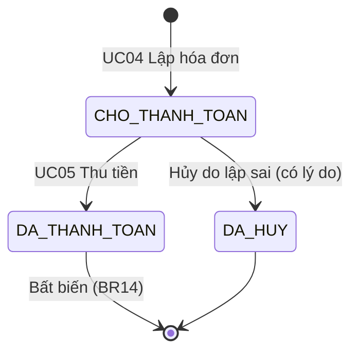

# ĐẶC TẢ YÊU CẦU NGHIỆP VỤ (MỐC M1)
## HỆ THỐNG QUẢN LÝ BỆNH VIỆN (MÃ ĐỀ TÀI: DT01)

* **Học phần:** Đồ án Cơ sở dữ liệu (Khoa CNTT – Bộ môn HTTT, Trường ĐH Công nghệ Giao thông vận tải)
* **Giảng viên hướng dẫn:** ThS. NCS Trần Đức Thắng
* **Nhóm thực hiện:** Nhóm 1 (Lớp: 75DCHT23)
* **Thành viên:**
  1. Nguyễn Vân Anh (Trưởng nhóm / Phân tích nghiệp vụ - TV1)
  2. Nguyễn Thị Thùy Dung (Thiết kế CSDL - TV2)
  3. Lương Tiến Dũng (Lập trình CSDL - TV3)
  4. Phùng Thị Minh Ánh (DBA - TV4)
  5. Đinh Tuấn Cường (Phát triển ứng dụng - TV5)

---

## CHƯƠNG 1: TỔNG QUAN HỆ THỐNG

### 1.1. Bối cảnh và Tính cấp thiết
Trong môi trường bệnh viện và các cơ sở y tế hiện đại, việc số hóa quy trình khám chữa bệnh là yêu cầu tiên quyết nhằm nâng cao chất lượng phục vụ, giảm thiểu thời gian chờ đợi của bệnh nhân, hạn chế sai sót trong kê đơn thuốc và tối ưu hóa quản lý tồn kho dược phẩm. Đồ án xây dựng một giải pháp cơ sở dữ liệu quan hệ mạnh mẽ, đảm bảo tính toàn vẹn cao, chống xung đột giao dịch khi nhiều bác sĩ cùng kê đơn và lưu vết kiểm toán chi tiết phục vụ giám sát y khoa.

### 1.2. Mục tiêu hệ thống
* **Chuẩn hóa quy trình nghiệp vụ:** Kết nối liền mạch luồng dữ liệu từ Tiếp đón $\rightarrow$ Khám bệnh $\rightarrow$ Chỉ định cận lâm sàng $\rightarrow$ Kê đơn thuốc $\rightarrow$ Phát thuốc $\rightarrow$ Thanh toán viện phí.
* **Đảm bảo tính toàn vẹn và an toàn dữ liệu:** Quản lý kho dược nghiêm ngặt theo số lô và hạn sử dụng; ngăn chặn tuyệt đối tình trạng kê vượt tồn kho thuốc khả dụng.
* **Kiểm toán và giám sát (Audit Trail):** Ghi nhận chi tiết mọi hành vi sửa đổi đơn thuốc dưới dạng cấu trúc `JSONB` trong PostgreSQL.
* **Hiệu năng và xử lý đồng thời:** Đảm bảo hệ thống vận hành chính xác dưới tải cao khi nhiều bác sĩ cùng thao tác trên các mặt hàng dược phẩm khan hiếm (xử lý Race Condition / Lost Update).
* **Phân quyền theo vai trò:** Mỗi tác nhân chỉ được đọc/ghi đúng phần dữ liệu cần cho công việc (nguyên tắc quyền tối thiểu), thực thi ở cả tầng ứng dụng và tầng CSDL (vai trò PostgreSQL, `GRANT/REVOKE`, view ẩn cột/hàng nhạy cảm) – chi tiết tại mục 2.7.

### 1.3. Công nghệ lựa chọn và Căn cứ kỹ thuật
* **Hệ quản trị CSDL:** PostgreSQL 18.x (Hỗ trợ JSONB hiệu năng cao, cơ chế khóa dòng mạnh mẽ, Partial Index, Window Functions và CTE đệ quy). PostgreSQL 19 vừa phát hành ngày 19/11/2026; nhóm chọn dòng 18 (bản ổn định, được hỗ trợ dài hạn) do Flyway/Testcontainers có thể chưa hỗ trợ đầy đủ bản 19.0, sẽ cân nhắc nâng cấp khi có 19.1.
* **Công nghệ ứng dụng:** Java 25 LTS, Spring Boot 4.1.x (bản ổn định mới nhất; dòng 3.x đã hết hỗ trợ mã nguồn mở), Spring Data JPA / Hibernate ORM 7.x (theo BOM của Spring Boot).
* **Quản lý phiên bản CSDL:** Flyway Migration (Đảm bảo DDL đồng bộ, không dùng ddl-auto update).
* **Kiểm thử tự động:** Testcontainers (Chạy test trên container PostgreSQL thật).
* **Đóng gói triển khai:** Docker & Docker Compose v2.

> Phiên bản chính xác (đến số bản vá) của từng công nghệ được ghi trong `README.md`.

### 1.4. Phạm vi hệ thống

**Trong phạm vi:**
* Khám bệnh **ngoại trú**: đặt lịch, tiếp đón, cấp số thứ tự, hàng đợi phòng khám.
* Hồ sơ hành chính bệnh nhân và thẻ BHYT.
* Khám, chẩn đoán, chỉ định cận lâm sàng (xét nghiệm, chẩn đoán hình ảnh), nhập và xem kết quả.
* Kê đơn thuốc điện tử có kiểm tra tồn kho tức thì; duyệt và xuất thuốc theo lô.
* Kho dược: nhập kho theo phiếu nhập và lô, cảnh báo hết hạn/dưới ngưỡng.
* Lập hóa đơn viện phí và thu tiền.
* Quản trị danh mục, nhân viên, tài khoản, vai trò; tra cứu nhật ký kiểm toán.

**Ngoài phạm vi (không thực hiện):**
* Điều trị **nội trú**, quản lý giường bệnh, phẫu thuật, cấp cứu.
* Kết nối thật với cổng giám định BHYT của BHXH Việt Nam.
* Tính BHYT theo tuyến (đúng tuyến/trái tuyến), trần thanh toán; tạm ứng, hoàn tiền, thanh toán trực tuyến.
* Kiểm tra tương tác thuốc tự động (dược sĩ kiểm tra thủ công).
* Kết nối máy xét nghiệm (LIS) và hệ thống lưu trữ ảnh (PACS).

**Giả định:**
* Mỗi ca khám có tối đa một đơn thuốc và một hóa đơn còn hiệu lực.
* BHYT chi trả = chi phí các mục thuộc danh mục BHYT × mức hưởng của thẻ còn hiệu lực tại ngày khám.
* Toàn bộ dữ liệu mẫu được **sinh tự động** bằng script (có tiếng Việt), không dùng dữ liệu cá nhân thật của bệnh nhân hay nhân viên.

---

## CHƯƠNG 2: PHÂN TÍCH YÊU CẦU NGHIỆP VỤ

### 2.1. Danh sách 5 Tác nhân (Actors)
1. **Quản trị viên (Admin):** Quản lý cấu hình toàn hệ thống, danh mục khoa phòng, quản lý nhân viên y tế, phân quyền bảo mật và tra cứu nhật ký kiểm toán (`AuditLog`).
2. **Nhân viên hành chính (Receptionist / Cashier):** Tiếp nhận bệnh nhân, tạo mới và cập nhật hồ sơ bệnh nhân, đặt lịch hẹn và phân phòng khám, lập hóa đơn và thu viện phí.
3. **Bác sĩ (Doctor):** Tiếp nhận ca khám bệnh, ghi nhận triệu chứng, chẩn đoán bệnh án, chỉ định các xét nghiệm/chẩn đoán hình ảnh, xem kết quả cận lâm sàng và kê đơn thuốc điện tử.
4. **Dược sĩ (Pharmacist):** Quản lý kho thuốc (nhập kho theo lô, theo dõi hạn dùng), duyệt đơn thuốc của bác sĩ, kiểm tra tương tác/tồn kho và xác nhận xuất thuốc cho bệnh nhân.
5. **Kỹ thuật viên cận lâm sàng (Lab / Imaging Technician):** Tiếp nhận chỉ định cận lâm sàng tại phòng xét nghiệm/chẩn đoán hình ảnh, chuyển trạng thái `DANG_THUC_HIEN` khi bắt đầu thực hiện, nhập kết quả và kết luận.

---

### 2.2. Bảng Danh mục 21 Use Cases

| Mã UC | Tên Use Case | Tác nhân chính | Mô tả tóm tắt | Tiền điều kiện | Hậu điều kiện |
| :---: | :--- | :--- | :--- | :--- | :--- |
| **UC01** | Đăng ký hồ sơ bệnh nhân | Hành chính | Nhập thông tin hành chính, số CCCD, thẻ BHYT (nếu có) của bệnh nhân mới. | Bệnh nhân chưa có trong hệ thống | Tạo bản ghi bệnh nhân mới kèm mã định danh |
| **UC02** | Tra cứu hồ sơ bệnh nhân | Hành chính, Bác sĩ | Tìm kiếm thông tin bệnh nhân qua CCCD, Số điện thoại hoặc Mã bệnh nhân. | Đã đăng nhập | Hiển thị hồ sơ hành chính & lịch sử khám cũ |
| **UC03** | Đặt lịch khám & phân phòng | Hành chính | Chọn chuyên khoa, bác sĩ phụ trách và tạo số thứ tự khám cho ca khám. | Đã có hồ sơ bệnh nhân | Ca khám ở trạng thái `CHO_KHAM` |
| **UC04** | Lập hóa đơn viện phí | Hành chính | Tổng hợp chi phí tiền khám, xét nghiệm và tiền thuốc thành hóa đơn. | Ca khám ở trạng thái `HOAN_THANH` (hoàn tất chỉ định/kê đơn), chưa có hóa đơn còn hiệu lực | Tạo hóa đơn ở trạng thái `CHO_THANH_TOAN` |
| **UC05** | Thu tiền & in biên lai | Hành chính | Ghi nhận tiền bệnh nhân thanh toán và in hóa đơn/biên lai. | Hóa đơn chưa thanh toán | Hóa đơn chuyển trạng thái `DA_THANH_TOAN` |
| **UC06** | Xem hàng đợi khám | Bác sĩ | Xem danh sách bệnh nhân đang chờ khám tại phòng khám của mình trong ngày. | Bác sĩ đã đăng nhập ca trực | Danh sách xếp theo số thứ tự tiếp đón |
| **UC07** | Khám bệnh & Ghi chẩn đoán | Bác sĩ | Bắt đầu ca khám, ghi nhận tiền sử bệnh, triệu chứng lâm sàng và kết luận bệnh án. | Trạng thái ca khám là `CHO_KHAM` | Chuyển trạng thái ca khám sang `DANG_KHAM` |
| **UC08** | Chỉ định dịch vụ cận lâm sàng | Bác sĩ | Chỉ định các xét nghiệm máu, nước tiểu, X-Quang, Siêu âm cho bệnh nhân. | Ca khám đang ở trạng thái `DANG_KHAM` | Tạo các dòng chỉ định ở trạng thái `CHO_THUC_HIEN` |
| **UC09** | Xem kết quả cận lâm sàng | Bác sĩ | Xem các chỉ số xét nghiệm và kết luận hình ảnh để củng cố chẩn đoán. | Kỹ thuật viên CLS đã nhập kết quả (UC18), chỉ định ở `CO_KET_QUA` | Bác sĩ có đủ dữ liệu để ra quyết định kê đơn |
| **UC10** | Kê đơn thuốc điện tử | Bác sĩ | Chọn thuốc, số lượng, hướng dẫn liều dùng; hệ thống kiểm tra tồn kho tức thì. | Ca khám đang `DANG_KHAM` | Tạo đơn thuốc `CHO_XUAT` liên kết với ca khám; số lượng tạm giữ của thuốc tăng tương ứng |
| **UC11** | Duyệt & Xuất thuốc theo đơn | Dược sĩ | Kiểm tra đơn thuốc, đối chiếu lô thuốc thực tế trong kho và xác nhận xuất thuốc. | Đơn thuốc ở trạng thái `CHO_XUAT` | Trừ tồn kho thực tế, đơn thuốc chuyển `DA_XUAT` |
| **UC12** | Nhập kho thuốc theo lô | Dược sĩ | Lập phiếu nhập kho thuốc mới gồm mã thuốc, số lô, hạn dùng, số lượng, giá nhập. | Có biên bản bàn giao kho dược | Tăng tồn kho theo lô tương ứng |
| **UC13** | Kiểm kê & Cảnh báo tồn kho | Dược sĩ | Tra cứu thuốc sắp hết hạn (< 30 ngày) hoặc số lượng tồn dưới ngưỡng an toàn. | Đã đăng nhập vai trò Dược sĩ | Hiển thị bảng cảnh báo phục vụ dự trù mua sắm |
| **UC14** | Quản lý danh mục y tế | Quản trị viên | Thêm/sửa thông tin khoa phòng, danh mục dịch vụ cận lâm sàng và danh mục thuốc. | Quyền Admin | Cập nhật bảng danh mục hệ thống |
| **UC15** | Quản lý nhân viên & Tài khoản | Quản trị viên | Tạo mới bác sĩ, điều dưỡng, nhân viên; cấp tài khoản và gán vai trò (`ROLE`). | Quyền Admin | Tạo tài khoản, mã hóa mật khẩu BCrypt |
| **UC16** | Tra cứu nhật ký kiểm toán | Quản trị viên | Xem lịch sử các thao tác nhạy cảm (sửa đơn thuốc, hủy chỉ định) lưu qua JSONB. | Quyền Admin | Hiển thị chi tiết bản ghi cũ/mới và người sửa |
| **UC17** | Hủy chỉ định cận lâm sàng | Bác sĩ | Hủy dịch vụ đã chỉ định nếu phát hiện nhầm lẫn hoặc bệnh nhân từ chối. | Dịch vụ đang `CHO_THUC_HIEN` | Hủy thành công, không tính tiền vào hóa đơn |
| **UC18** | Thực hiện CLS & Nhập kết quả | Kỹ thuật viên CLS | Xem danh sách chỉ định chờ tại phòng mình, bắt đầu thực hiện, nhập kết quả và kết luận. | Chỉ định ở trạng thái `CHO_THUC_HIEN` | Chỉ định chuyển `DANG_THUC_HIEN` rồi `CO_KET_QUA` |
| **UC19** | Kết thúc ca khám | Bác sĩ | Chốt kết luận, hướng điều trị, hẹn tái khám (nếu có) và đóng ca khám. | Ca khám `DANG_KHAM`, đã có chẩn đoán, không còn chỉ định ở `CHO_THUC_HIEN`/`DANG_THUC_HIEN` | Ca khám chuyển `HOAN_THANH`, sẵn sàng lập hóa đơn |
| **UC20** | Hủy lịch hẹn / ca khám | Hành chính | Hủy lịch hẹn hoặc ca khám chưa bắt đầu theo yêu cầu của bệnh nhân. | Ca khám ở trạng thái `CHO_KHAM` | Ca khám chuyển `DA_HUY` (bắt buộc ghi lý do); khung giờ của bác sĩ được giải phóng |
| **UC21** | Sửa / Hủy đơn thuốc chưa xuất | Bác sĩ | Thay đổi số lượng, liều dùng, thêm/bớt thuốc hoặc hủy toàn bộ đơn thuốc. | Đơn thuốc ở `CHO_XUAT` và ca khám đang `DANG_KHAM` | Đơn được cập nhật hoặc chuyển `DA_HUY`; số lượng tạm giữ được điều chỉnh/giải phóng; thao tác được ghi audit |

---

### 2.3. Bảng 15 Quy tắc nghiệp vụ bắt buộc (Business Rules - BR)

| Mã BR | Tên quy tắc nghiệp vụ | Mô tả đặc tả chi tiết | Giải pháp CSDL đảm bảo |
| :---: | :--- | :--- | :--- |
| **BR01** | Tránh trùng lịch khám bác sĩ | Trong cùng một khung giờ của một ngày, một bác sĩ không được phép có $\ge 2$ lịch hẹn khám trùng nhau. | `UNIQUE (bac_si_id, ngay_kham, ca_kham)` hoặc `EXCLUSION CONSTRAINT` trên khoảng thời gian |
| **BR02** | Ràng buộc luồng ca khám | Bác sĩ chỉ được phép chỉ định cận lâm sàng hoặc kê đơn thuốc khi trạng thái ca khám đang là `DANG_KHAM`. | Ràng buộc `CHECK (trang_thai IN ('CHO_KHAM', 'DANG_KHAM', 'HOAN_THANH', 'DA_HUY'))` và Trigger validate |
| **BR03** | Chặn kê đơn vượt tồn kho | *(Yêu cầu trọng tâm DT01)* Số lượng thuốc kê trong chi tiết đơn thuốc không được vượt quá số lượng tồn khả dụng trong kho (`so_luong_ton - so_luong_tam_giu`). Nếu vi phạm, hệ thống phải chặn ngay lập tức. Trong đó: `so_luong_ton` = tổng tồn của các lô **còn hạn** của thuốc đó; `so_luong_tam_giu` = tổng số lượng của thuốc đó trong các đơn đang `CHO_XUAT` (tăng khi kê đơn – UC10; giảm khi xuất – UC11, khi sửa giảm hoặc hủy đơn – UC21). Quy tắc phải đúng cả khi **nhiều bác sĩ kê đồng thời** cùng một thuốc. | **Trigger `BEFORE INSERT OR UPDATE`** trên bảng `chi_tiet_don_thuoc` bắn ngoại lệ `RAISE EXCEPTION`. Trước khi tính tồn khả dụng, trigger khóa dòng thuốc bằng `SELECT … FROM thuoc WHERE thuoc_id = NEW.thuoc_id FOR UPDATE` để tuần tự hóa các giao dịch cùng thuốc. Nếu không khóa, ở mức cô lập mặc định READ COMMITTED hai giao dịch có thể cùng đọc một số tồn và cùng vượt qua kiểm tra – đây là lỗi đồng thời nhóm sẽ tái hiện rồi khắc phục. |
| **BR04** | Kiểm soát hạn dùng thuốc | Thuốc có hạn sử dụng nhỏ hơn ngày hiện tại (`han_su_dung < CURRENT_DATE`) hoặc tồn kho $\le 0$ không được phép xuất hiện để bác sĩ kê đơn hoặc dược sĩ xuất kho. | `CHECK (han_su_dung > ngay_san_xuat)` + View lọc thuốc khả dụng (`WHERE han_su_dung >= CURRENT_DATE AND so_luong_ton > 0`). View chỉ lọc khi hiển thị, nên bổ sung trigger trên bảng phân bổ lô khi xuất (`chi_tiet_xuat_lo`) từ chối lô đã hết hạn hoặc hết tồn. |
| **BR05** | Bất biến đơn thuốc đã xuất | Đơn thuốc sau khi đã chuyển sang trạng thái `DA_XUAT` (Dược sĩ đã giao thuốc) thì bị khóa vĩnh viễn, cấm mọi thao tác `UPDATE` số lượng hoặc `DELETE`. Quy tắc áp dụng cả cho các dòng chi tiết của đơn: cấm `INSERT/UPDATE/DELETE` trên `chi_tiet_don_thuoc` khi đơn cha đã `DA_XUAT`. | **Trigger `BEFORE UPDATE OR DELETE`** trên bảng `don_thuoc` từ chối nếu `OLD.trang_thai = 'DA_XUAT'`, và **Trigger `BEFORE INSERT OR UPDATE OR DELETE`** trên bảng `chi_tiet_don_thuoc` từ chối nếu đơn cha có `trang_thai = 'DA_XUAT'` |
| **BR06** | Kiểm toán sửa đổi qua JSONB | *(Yêu cầu trọng tâm DT01)* Mọi thao tác chỉnh sửa đơn thuốc hoặc chi tiết đơn thuốc, và mọi thao tác hủy chỉ định cận lâm sàng (`chi_tiet_chi_dinh`), phải tự động ghi vào bảng `audit_log`. Cột `data_changes` kiểu `JSONB` phải lưu trọn vẹn trạng thái cũ (`to_jsonb(OLD)`) và mới (`to_jsonb(NEW)`). Mỗi bản ghi lưu thêm tên bảng, loại thao tác, **người thực hiện** (tài khoản ứng dụng) và thời điểm. Nhật ký chỉ được ghi thêm, không được sửa/xóa. | **Trigger `AFTER UPDATE OR DELETE`** tự động đóng gói dữ liệu sang `JSONB` và ghi log kiểm toán. Do ứng dụng kết nối CSDL bằng một tài khoản chung, đầu mỗi giao dịch ứng dụng chạy `set_config('app.current_user_id', <id tài khoản>, true)`; trigger đọc lại bằng `current_setting('app.current_user_id', true)`. `REVOKE UPDATE, DELETE ON audit_log` với mọi vai trò. |
| **BR07** | Nhất quán tiền hóa đơn | Tổng số tiền thanh toán của hóa đơn phải bằng chính xác: $\text{Tiền khám} + \sum(\text{Dịch vụ CLS không bị hủy}) + \sum(\text{Tiền thuốc}) - \text{BHYT chi trả}$. Chỉ định ở trạng thái `DA_HUY` (UC17) không được tính. BHYT chi trả = tổng chi phí các mục thuộc danh mục BHYT × mức hưởng của thẻ còn hiệu lực tại ngày khám (không có thẻ hợp lệ thì bằng 0) và không vượt tổng chi phí. Số tiền thanh toán không bao giờ được âm. | `CHECK (tong_tien >= 0)` + `CHECK (tong_tien = tien_kham + tien_cls + tien_thuoc - bhyt_chi_tra)` + Stored Procedure quyết toán hoặc Trigger đồng bộ tính toán |
| **BR08** | Tính duy nhất định danh bệnh nhân | Số CCCD/Định danh cá nhân của bệnh nhân là duy nhất trong toàn hệ thống. Mã thẻ BHYT (nếu có) phải gồm đúng 15 ký tự theo quy định chuẩn của Bảo hiểm Xã hội Việt Nam. Số CCCD gồm đúng 12 chữ số, được để trống với trẻ em hoặc bệnh nhân chưa xác định danh tính. Mã thẻ BHYT được lưu ở thực thể yếu `TheBHYT` (không lưu trong `BenhNhan`), dạng 2 chữ cái mã đối tượng + 13 chữ số. | `UNIQUE (cccd)` và `CHECK (cccd IS NULL OR cccd ~ '^[0-9]{12}$')` trên `benh_nhan`; trên `the_bhyt`: `UNIQUE (ma_bhyt)` và `CHECK (ma_bhyt ~ '^[A-Z]{2}[0-9]{13}$')` (bảo đảm đúng 15 ký tự) |
| **BR09** | Điều kiện hủy cận lâm sàng | Bác sĩ chỉ được phép hủy chỉ định cận lâm sàng khi trạng thái của dịch vụ đó đang là `CHO_THUC_HIEN`. Khi kỹ thuật viên xét nghiệm đã bấm `DANG_THUC_HIEN` thì không được hủy. | Trigger kiểm tra trạng thái trước khi cho phép `DELETE` hoặc chuyển cờ hủy |
| **BR10** | Toàn vẹn xóa logic (Soft Delete) | Không được phép `DELETE` vật lý các bản ghi danh mục thuốc, dịch vụ hoặc nhân viên y tế đã từng phát sinh liên kết với hồ sơ bệnh án cũ nhằm bảo tồn lịch sử y khoa. Sử dụng cờ `is_active = FALSE`. | Ràng buộc khóa ngoại `ON DELETE RESTRICT` trên các bảng giao dịch chính |
| **BR11** | Xuất kho theo lô FEFO, không âm tồn | Khi xuất đơn, số lượng mỗi thuốc được phân bổ vào các lô còn hạn theo hạn dùng tăng dần (lô hết hạn trước xuất trước). Tổng số lượng phân bổ phải bằng đúng số lượng kê; tồn của một lô không bao giờ âm, kể cả khi hai dược sĩ xuất đồng thời từ cùng một lô. | Stored Procedure `sp_xuat_don_thuoc`: khóa các lô liên quan `FOR UPDATE` theo thứ tự `lo_thuoc_id` (tránh deadlock), cập nhật nguyên tử `so_luong_ton = so_luong_ton - x`, ghi `chi_tiet_xuat_lo`; `CHECK (so_luong_ton >= 0)` trên `lo_thuoc` là chốt chặn cuối |
| **BR12** | Quyền sở hữu ca khám | Bác sĩ chỉ được ghi chẩn đoán, chỉ định/hủy chỉ định cận lâm sàng, kê/sửa/hủy đơn thuốc và kết thúc ca khám đối với **ca khám do chính mình phụ trách**. | Trigger trên `ca_kham`, `chi_tiet_chi_dinh`, `don_thuoc`, `chi_tiet_don_thuoc` so sánh `ca_kham.bac_si_id` với nhân viên ứng với `current_setting('app.current_user_id')`; view hàng đợi chỉ trả ca khám của bác sĩ đang đăng nhập |
| **BR13** | Bảo vệ dữ liệu nhạy cảm theo vai trò | Nhân viên hành chính không được xem chẩn đoán, kết quả cận lâm sàng và nội dung đơn thuốc. Dược sĩ và kỹ thuật viên CLS chỉ thấy thông tin tối thiểu của bệnh nhân (mã, họ tên, năm sinh, giới tính), không thấy CCCD, số điện thoại, địa chỉ. Quản trị viên không trực tiếp đọc dữ liệu lâm sàng (chỉ xem qua nhật ký kiểm toán). | Mỗi tác nhân một vai trò CSDL (`r_admin`, `r_hanh_chinh`, `r_bac_si`, `r_duoc_si`, `r_ktv`), `GRANT/REVOKE` theo ma trận mục 2.7.2; view ẩn cột/hàng nhạy cảm (`v_benh_nhan_co_ban`, `v_hang_doi_bac_si`); ứng dụng không dùng tài khoản quản trị CSDL |
| **BR14** | Hóa đơn duy nhất và bất biến | Mỗi ca khám có tối đa một hóa đơn còn hiệu lực (không ở `DA_HUY`). Hóa đơn đã `DA_THANH_TOAN` không được sửa số tiền hoặc xóa. | Partial unique index `UNIQUE (ca_kham_id) WHERE trang_thai <> 'DA_HUY'` trên `hoa_don`; Trigger `BEFORE UPDATE OR DELETE` trên `hoa_don` từ chối nếu `OLD.trang_thai = 'DA_THANH_TOAN'` |
| **BR15** | Tính hợp lệ của số lượng, đơn giá và ngày | Số lượng kê, số lượng chỉ định, số lượng nhập kho phải $> 0$; đơn giá dịch vụ, giá nhập, giá bán thuốc phải $\ge 0$; ngày sinh của bệnh nhân không được lớn hơn ngày hiện tại. | `CHECK (so_luong > 0)`, `CHECK (don_gia >= 0)` trên các bảng liên quan; Trigger kiểm tra `ngay_sinh <= CURRENT_DATE` (không đặt `CURRENT_DATE` trong `CHECK` vì `CHECK` phải là biểu thức bất biến) |

---

### 2.4. Sơ đồ Use Case tổng quát

> Sơ đồ Mermaid dưới đây (GitHub hiển thị trực tiếp) là bản xem nhanh; sơ đồ use case chính thức theo ký pháp UML được vẽ bằng draw.io/StarUML và lưu tại `docs/`.

```mermaid
flowchart LR
    AD(["👤 Quản trị viên"])
    HC(["👤 Hành chính"])
    BS(["👤 Bác sĩ"])
    DS(["👤 Dược sĩ"])
    KT(["👤 Kỹ thuật viên CLS"])

    subgraph HT["Hệ thống quản lý bệnh viện"]
        UC01(("UC01 Đăng ký hồ sơ BN"))
        UC02(("UC02 Tra cứu hồ sơ BN"))
        UC03(("UC03 Đặt lịch & phân phòng"))
        UC20(("UC20 Hủy lịch hẹn / ca khám"))
        UC04(("UC04 Lập hóa đơn"))
        UC05(("UC05 Thu tiền & in biên lai"))
        UC06(("UC06 Xem hàng đợi"))
        UC07(("UC07 Khám & ghi chẩn đoán"))
        UC08(("UC08 Chỉ định CLS"))
        UC17(("UC17 Hủy chỉ định CLS"))
        UC09(("UC09 Xem kết quả CLS"))
        UC10(("UC10 Kê đơn thuốc"))
        UC21(("UC21 Sửa / hủy đơn chưa xuất"))
        UC19(("UC19 Kết thúc ca khám"))
        UC18(("UC18 Thực hiện CLS & nhập kết quả"))
        UC11(("UC11 Duyệt & xuất thuốc"))
        UC12(("UC12 Nhập kho theo lô"))
        UC13(("UC13 Kiểm kê & cảnh báo"))
        UC14(("UC14 Quản lý danh mục"))
        UC15(("UC15 Nhân viên & tài khoản"))
        UC16(("UC16 Tra cứu nhật ký kiểm toán"))
    end

    HC --- UC01 & UC02 & UC03 & UC20 & UC04 & UC05
    BS --- UC02 & UC06 & UC07 & UC08 & UC17 & UC09 & UC10 & UC21 & UC19
    KT --- UC18
    DS --- UC11 & UC12 & UC13
    AD --- UC14 & UC15 & UC16
```

---

### 2.5. Đặc tả chi tiết các Use Case trọng tâm

#### UC10 – Kê đơn thuốc điện tử
* **Tác nhân:** Bác sĩ
* **Tiền điều kiện:** Ca khám `DANG_KHAM`, do bác sĩ đang đăng nhập phụ trách; ca khám chưa có đơn thuốc còn hiệu lực.
* **Luồng chính:**
  1. Bác sĩ mở màn hình kê đơn; hệ thống hiển thị danh sách thuốc khả dụng (đang hoạt động, có lô còn hạn, tồn khả dụng > 0) kèm số tồn khả dụng.
  2. Bác sĩ chọn thuốc, nhập số lượng, liều dùng (sáng/trưa/chiều/tối), số ngày dùng, cách dùng.
  3. Lặp lại bước 2 cho các thuốc khác.
  4. Bác sĩ bấm **Lưu đơn**. Trong **một giao dịch**, hệ thống tạo `DonThuoc` trạng thái `CHO_XUAT` và các dòng `ChiTietDonThuoc`; với mỗi dòng, trigger khóa dòng thuốc, tính tồn khả dụng và chặn nếu vượt.
  5. Hệ thống báo lưu thành công; số lượng tạm giữ của các thuốc tăng tương ứng.
* **Luồng thay thế / ngoại lệ:**
  * 4a. Số lượng kê của một thuốc vượt tồn khả dụng → toàn bộ giao dịch bị hủy (ROLLBACK), hệ thống báo *"BR03: Thuốc X chỉ còn N đơn vị khả dụng"*; bác sĩ giảm số lượng hoặc chọn thuốc khác.
  * 4b. Hai bác sĩ cùng kê một thuốc chỉ còn ít → giao dịch đến sau phải chờ khóa; sau khi giao dịch trước hoàn tất, giao dịch sau tính lại tồn khả dụng và bị chặn nếu không đủ.
  * 4c. Thuốc chỉ còn lô hết hạn hoặc đã ngừng sử dụng → bị chặn (BR04, BR10).
  * 4d. Ca khám không do bác sĩ phụ trách hoặc không ở `DANG_KHAM` → bị chặn (BR02, BR12).
* **Hậu điều kiện:** Đơn thuốc `CHO_XUAT` gắn với ca khám.
* **Quy tắc liên quan:** BR02, BR03, BR04, BR10, BR12, BR15.

#### UC11 – Duyệt & Xuất thuốc theo đơn
* **Tác nhân:** Dược sĩ
* **Tiền điều kiện:** Đơn thuốc ở trạng thái `CHO_XUAT`.
* **Luồng chính:**
  1. Dược sĩ tìm đơn theo mã bệnh nhân hoặc mã đơn.
  2. Hệ thống hiển thị chi tiết đơn và đề xuất phân bổ lô theo FEFO (lô có hạn dùng gần nhất, còn hạn, còn tồn được lấy trước).
  3. Dược sĩ kiểm tra đơn, đối chiếu thuốc thực tế, bấm **Xác nhận xuất**.
  4. Hệ thống gọi `sp_xuat_don_thuoc` trong một giao dịch: khóa các lô liên quan, ghi `ChiTietXuatLo`, trừ `so_luong_ton` từng lô, kiểm tra tổng phân bổ bằng số lượng kê, chuyển đơn sang `DA_XUAT`, ghi người xuất và thời điểm.
* **Luồng thay thế / ngoại lệ:**
  * 3a. Dược sĩ phát hiện vấn đề (tương tác thuốc, sai liều) → không xuất, liên hệ bác sĩ để sửa đơn (UC21) khi ca khám còn `DANG_KHAM`.
  * 4a. Tồn thực tế tại thời điểm xuất không đủ (ví dụ lô vừa hết hạn) → ROLLBACK và báo lỗi (BR04, BR11).
  * 4b. Hai dược sĩ cùng xuất từ một lô → không mất cập nhật, tồn lô không âm (BR11).
* **Hậu điều kiện:** Tồn thực tế giảm; số lượng tạm giữ giảm tương ứng; đơn bị khóa vĩnh viễn (BR05).
* **Quy tắc liên quan:** BR04, BR05, BR11.

---

### 2.6. Vòng đời trạng thái

Mọi cột trạng thái được ràng buộc bằng `CHECK (trang_thai IN (...))`; các chuyển trạng thái hợp lệ dưới đây được kiểm soát bằng trigger (vì `CHECK` không so sánh được với giá trị cũ).

#### a) Ca khám (`CaKham`)

#### b) Chỉ định cận lâm sàng (`ChiTietChiDinh`)

#### c) Đơn thuốc (`DonThuoc`)

#### d) Hóa đơn (`HoaDon`)

| Đối tượng | Chuyển trạng thái | Ai thực hiện | Use case |
| :--- | :--- | :--- | :--- |
| Ca khám | → `CHO_KHAM` | Hành chính | UC03 |
| Ca khám | `CHO_KHAM` → `DANG_KHAM` | Bác sĩ phụ trách | UC07 |
| Ca khám | `DANG_KHAM` → `HOAN_THANH` | Bác sĩ phụ trách | UC19 |
| Ca khám | `CHO_KHAM` → `DA_HUY` | Hành chính | UC20 |
| Chỉ định CLS | → `CHO_THUC_HIEN` | Bác sĩ phụ trách | UC08 |
| Chỉ định CLS | `CHO_THUC_HIEN` → `DANG_THUC_HIEN` → `CO_KET_QUA` | Kỹ thuật viên CLS | UC18 |
| Chỉ định CLS | `CHO_THUC_HIEN` → `DA_HUY` | Bác sĩ phụ trách | UC17 |
| Đơn thuốc | → `CHO_XUAT`; `CHO_XUAT` → `DA_HUY` | Bác sĩ phụ trách | UC10, UC21 |
| Đơn thuốc | `CHO_XUAT` → `DA_XUAT` | Dược sĩ | UC11 |
| Hóa đơn | → `CHO_THANH_TOAN`; → `DA_THANH_TOAN` | Hành chính | UC04, UC05 |

---

### 2.7. Ma trận phân quyền theo vai trò

#### 2.7.1. Phân quyền theo Use Case

| Use case | Admin | Hành chính | Bác sĩ | Dược sĩ | KTV CLS |
| :--- | :---: | :---: | :---: | :---: | :---: |
| UC01 Đăng ký hồ sơ BN | | ✔ | | | |
| UC02 Tra cứu hồ sơ BN | | ✔ (hành chính) | ✔ (kèm lịch sử khám) | | |
| UC03 Đặt lịch & phân phòng | | ✔ | | | |
| UC04 Lập hóa đơn | | ✔ | | | |
| UC05 Thu tiền & in biên lai | | ✔ | | | |
| UC06 Xem hàng đợi khám | | | ✔ (của mình) | | |
| UC07 Khám & ghi chẩn đoán | | | ✔ (của mình) | | |
| UC08 Chỉ định CLS | | | ✔ (của mình) | | |
| UC09 Xem kết quả CLS | | | ✔ | | |
| UC10 Kê đơn thuốc | | | ✔ (của mình) | | |
| UC11 Duyệt & xuất thuốc | | | | ✔ | |
| UC12 Nhập kho theo lô | | | | ✔ | |
| UC13 Kiểm kê & cảnh báo | | | | ✔ | |
| UC14 Quản lý danh mục | ✔ | | | | |
| UC15 Nhân viên & tài khoản | ✔ | | | | |
| UC16 Nhật ký kiểm toán | ✔ | | | | |
| UC17 Hủy chỉ định CLS | | | ✔ (của mình) | | |
| UC18 Thực hiện CLS | | | | | ✔ (phòng mình) |
| UC19 Kết thúc ca khám | | | ✔ (của mình) | | |
| UC20 Hủy lịch hẹn / ca khám | | ✔ | | | |
| UC21 Sửa / hủy đơn chưa xuất | | | ✔ (của mình) | | |

#### 2.7.2. Phân quyền theo bảng dữ liệu (định hướng `GRANT/REVOKE` ở mốc M3)

Ký hiệu: **C** = INSERT, **R** = SELECT, **U** = UPDATE; **(v)** = chỉ đọc qua view hạn chế; **–** = không có quyền. Không vai trò nào có quyền `DELETE` vật lý trên bảng nghiệp vụ (BR10).

| Bảng | r_admin | r_hanh_chinh | r_bac_si | r_duoc_si | r_ktv |
| :--- | :---: | :---: | :---: | :---: | :---: |
| `khoa_phong`, `dich_vu_cls` | CRU | R | R | R | R |
| `thuoc`, `nha_cung_cap` | CRU | – | R (`thuoc`) | R | – |
| `nhan_vien`, `lich_truc` | CRU | R (v) | R (v) | R (v) | R (v) |
| `vai_tro`, `tai_khoan` | CRU | – | – | – | – |
| `benh_nhan` | – | CRU | R | R (v) | R (v) |
| `the_bhyt` | – | CRU | R | – | – |
| `lich_hen` | – | CRU | R | – | – |
| `ca_kham` | – | CRU (tạo, hủy) | RU (của mình) | R (v) | R (v) |
| `chi_tiet_chi_dinh` | – | – | CRU (của mình) | – | RU (kết quả, trạng thái) |
| `don_thuoc`, `chi_tiet_don_thuoc` | – | – | CRU (của mình) | RU (trạng thái xuất) | – |
| `phieu_nhap_kho`, `lo_thuoc` | – | – | R (v: tồn khả dụng) | CRU | – |
| `chi_tiet_xuat_lo` | – | – | – | CR | – |
| `hoa_don` | – | CRU | – | – | – |
| `audit_log` | R | – | – | – | – |

> Hành chính lập hóa đơn thông qua Stored Procedure quyết toán (`SECURITY DEFINER`) nên không cần quyền đọc trực tiếp nội dung chỉ định và đơn thuốc (BR13).

#### 2.7.3. Vai trò CSDL và View phân quyền

| Đối tượng | Mô tả |
| :--- | :--- |
| `hms_owner` | Tài khoản sở hữu schema, chỉ dùng cho Flyway migration và sao lưu; ứng dụng **không** dùng tài khoản này. |
| `hms_app` | Tài khoản kết nối của ứng dụng (`NOSUPERUSER`), là thành viên của các vai trò `r_*`; đầu mỗi giao dịch chạy `SET LOCAL ROLE r_<vai trò>` theo người dùng đăng nhập. |
| `r_admin`, `r_hanh_chinh`, `r_bac_si`, `r_duoc_si`, `r_ktv` | Vai trò nhóm (NOLOGIN) mang quyền theo bảng 2.7.2. |
| `v_benh_nhan_co_ban` | Cho Dược sĩ, KTV: chỉ mã BN, họ tên, năm sinh, giới tính (ẩn CCCD, SĐT, địa chỉ). |
| `v_hang_doi_bac_si` | Cho Bác sĩ: chỉ các ca khám của bác sĩ đang đăng nhập (lọc hàng). |
| `v_nhan_vien_cong_khai` | Cho các vai trò không phải Admin: ẩn thông tin cá nhân của nhân viên và thông tin tài khoản. |
| `v_thuoc_kha_dung` | Cho Bác sĩ: thuốc còn tồn khả dụng (BR03, BR04), không lộ giá nhập, nhà cung cấp. |

Mật khẩu các tài khoản CSDL đặt trong biến môi trường (`.env`), repo chỉ chứa `.env.example`.

---

## CHƯƠNG 3: BƯỚC ĐỆM CHUẨN BỊ CHO THIẾT KẾ CSDL (MỐC M2)

Từ 21 Use Cases và 15 Quy tắc nghiệp vụ trên, phân hệ dữ liệu dự kiến được phân công cho **TV2 (Nguyễn Thị Thùy Dung)** xây dựng mô hình ERD với các thực thể cốt lõi sau:

1. `KhoaPhong` (Phòng ban/Chuyên khoa - Phân cấp cây)
2. `NhanVien` (Bác sĩ, Điều dưỡng, Dược sĩ, Nhân viên)
3. `TaiKhoan` (Tài khoản người dùng, quan hệ 1-1 với `NhanVien`)
4. `BenhNhan` (Hồ sơ bệnh nhân)
5. `TheBHYT` (Thực thể yếu phụ thuộc vào `BenhNhan`)
6. `LichHen` (Lịch hẹn khám của bệnh nhân)
7. `HoSoKham` / `CaKham` (Hồ sơ từng đợt khám bệnh)
8. `DichVuCLS` (Danh mục dịch vụ xét nghiệm, chẩn đoán)
9. `ChiTietChiDinh` (Bảng nối n-n giữa `CaKham` và `DichVuCLS`; lưu cả trạng thái, kỹ thuật viên thực hiện, kết quả và kết luận CLS)
10. `Thuoc` (Danh mục biệt dược, hoạt chất)
11. `LoThuoc` (Thực thể yếu theo dõi số lô, hạn dùng, tồn kho của `Thuoc`)
12. `DonThuoc` (Đơn thuốc điện tử gắn với `CaKham`)
13. `ChiTietDonThuoc` (Bảng nối n-n giữa `DonThuoc` và `Thuoc` – bác sĩ kê theo thuốc, xem QĐ01)
14. `HoaDon` (Hóa đơn viện phí)
15. `AuditLog` (Bảng nhật ký kiểm toán chứa cột `data_changes JSONB`)
16. `VaiTro` (Vai trò người dùng: ADMIN, HANH_CHINH, BAC_SI, DUOC_SI, KTV; ánh xạ sang vai trò CSDL)
17. `NhaCungCap` (Nhà cung cấp dược phẩm)
18. `PhieuNhapKho` (Phiếu nhập kho của UC12; một phiếu gồm nhiều `LoThuoc`)
19. `ChiTietXuatLo` (Bảng nối n-n giữa `ChiTietDonThuoc` và `LoThuoc` – số lượng xuất từ từng lô theo FEFO, xem QĐ01)
20. `LichTruc` (Ca trực của nhân viên theo ngày và phòng, phục vụ UC06)

> Theo quy định học thuật của học phần, ERD và chuẩn hóa do nhóm tự thực hiện; danh sách trên là đầu vào, TV2 có quyền điều chỉnh khi thiết kế.

### 3.1. Quyết định thiết kế đã chốt ở mốc M1

| Mã | Quyết định | Lý do | Phương án đã loại |
| :---: | :--- | :--- | :--- |
| **QĐ01** | Bác sĩ kê đơn theo **Thuốc** (`ChiTietDonThuoc` nối `DonThuoc`–`Thuoc`); dược sĩ xuất theo **Lô** qua `ChiTietXuatLo`, phân bổ FEFO. | Đúng thực tế: bác sĩ không chọn lô; liều dùng gắn với thuốc nên không bị tách dòng theo lô; chọn lô là nghiệp vụ của kho (UC11 "đối chiếu lô thuốc thực tế"). | Kê trực tiếp theo lô (`ChiTietDonThuoc` nối `LoThuoc`): một thuốc có thể bị tách thành nhiều dòng, bác sĩ phải biết lô. |
| **QĐ02** | `so_luong_tam_giu` là giá trị **tính động** từ các đơn `CHO_XUAT`, không lưu thành cột; các giao dịch cùng thuốc được tuần tự hóa bằng khóa dòng `thuoc … FOR UPDATE`. | Không lưu dữ liệu dẫn xuất nên lược đồ giữ 3NF, không có nguy cơ lệch số; một dòng `thuoc` là điểm khóa duy nhất cho mỗi thuốc. | Lưu cột `so_luong_tam_giu` (phi chuẩn hóa): đọc nhanh hơn nhưng phải đồng bộ bằng trigger ở mọi luồng (kê, sửa, hủy, xuất). Sẽ cân nhắc lại ở M4 nếu `EXPLAIN ANALYZE` cho thấy chậm; khi đó phải nêu lý do và cách giữ nhất quán. |
| **QĐ03** | Người thực hiện trong nhật ký kiểm toán được truyền từ ứng dụng xuống trigger bằng `set_config('app.current_user_id', …, true)`. | Ứng dụng dùng một tài khoản kết nối chung nên `current_user` của CSDL không cho biết người dùng thật; biến cấu hình cục bộ theo giao dịch an toàn với connection pool. | Ghi audit ở tầng ứng dụng (Hibernate Envers): bỏ sót thay đổi thực hiện trực tiếp trên CSDL. |

---

## PHỤ LỤC: LỊCH SỬ THAY ĐỔI

| Phiên bản | Ngày | Nội dung |
| :---: | :---: | :--- |
| 1.0 | 11/2026 | Bản đầu: 4 tác nhân, 17 use case, 10 quy tắc nghiệp vụ, 15 thực thể. |
| 1.1 | 25/11/2026 | Giữ nguyên các phần đã đạt; bổ sung/sửa các phần còn thiếu: cập nhật phiên bản công nghệ (mục 1.3); thêm mục tiêu phân quyền (1.2) và mục Phạm vi (1.4); thêm tác nhân Kỹ thuật viên CLS; thêm UC18–UC21; thống nhất trạng thái chỉ định CLS (UC08, UC09) và vòng đời ca khám (UC04, UC05); làm rõ tạm giữ và chống race condition (BR03); bổ sung BR04–BR08; thêm BR11–BR15; thêm sơ đồ use case (2.4), đặc tả chi tiết UC10/UC11 (2.5), vòng đời trạng thái (2.6), ma trận phân quyền (2.7); bổ sung thực thể 16–20 và các quyết định thiết kế QĐ01–QĐ03. |

## PHỤ LỤC: KHAI BÁO SỬ DỤNG CÔNG CỤ AI

Theo quy định học thuật của học phần, nhóm khai báo: bản 1.1 của tài liệu được rà soát và bổ sung với sự hỗ trợ của công cụ AI (Claude – Anthropic) trên cơ sở bản 1.0 do nhóm tự viết. Nhóm đã kiểm tra lại toàn bộ nội dung và chịu trách nhiệm về tài liệu. ERD, chuẩn hóa và mã SQL ở các mốc sau do nhóm tự thực hiện; AI chỉ được dùng để rà soát.
